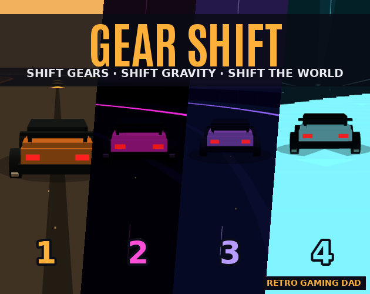

# Gear Shift

**Retro Gaming Dad** · [Game Off 2026](https://itch.io/jam/game-off-2026) entry · theme **Shift** · version 1.0.7 · #GitHubGameOff

An arcade racer where shifting gears also shifts the track's gravity and the world's colors.

- **Gear 1 · Drive:** planted golden-hour asphalt
- **Gear 2 · Surge:** neon night speed
- **Gear 3 · Drift:** low-gravity aurora air, hang the jumps
- **Gear 4 · Flip:** gravity turns over, race the underside of the course

Every track hides a Flip shortcut. Hit gear 4 when **FLIP** shows, ride the ceiling, then shift down over the landing road to drop back onto it. Flip in empty air and you stall.

**Platform:** PC, in a desktop browser with WebGL. Play with a keyboard or a gamepad. This jam build is made for desktop; phones and tablets are not supported.

## Modes

- **Time Trial:** race your ghost for Bronze, Silver, and Gold, then chase the Dad time. A tinted target ghost drives the next medal you have not earned yet.
- **Arcade Cup:** three heats against four rivals, scored 9-6-4-3-2.
- **Quick Race:** one race against the rivals on any open track.

Three circuits: Warm-Up Yard, Coastal Switchback, and Skyway Split. From any results screen, **Dad Card** shows a 1200×630 picture of your run that you can save as a PNG or copy. Nothing is uploaded.

## Controls

Click the game first so it gets keyboard focus and sound.

| Action | Keyboard | Gamepad |
|--------|----------|---------|
| Accelerate | W / Up | Right trigger |
| Brake / reverse | S / Down | Left trigger |
| Steer | A / D or Left / Right | Left stick |
| Shift up | E, X, or Right Shift | Right bumper |
| Shift down | Q, Z, or Left Shift | Left bumper |
| Handbrake / drift | Space | A / Cross |
| Pause | P or Esc | Start / Options |
| Restart | R | Back / Share, or Y / Triangle if it is free |
| Settings | F2 | Pause → Settings |
| Mute | M | — |
| Menus | Arrows, Enter, Esc | D-pad or left stick, A, B, Start, LB / RB |

Every driving control can be remapped in Settings → Controls. Settings also has volumes, screen shake, reduced flash, Auto quality, Target ghost, Rivals (Easy or Normal), and Low / Mid / High quality. If the game runs slowly, pick Low.

## Run it locally

No install or build step; the game is plain static files (HTML, JavaScript, and a vendored Three.js).

- Serve the folder with any static server, for example `python -m http.server 8000`, then open `http://localhost:8000/`.
- Opening `index.html` straight from disk also works in Chrome, Edge, and Firefox.

Progress and settings are saved in the browser's local storage (`gearshift_v1`). If WebGL is missing, the game shows a message instead of a blank screen.

## Project layout

- `index.html`: page, HUD, menus, and styles
- `src/`: game code (`game.js` flow and rendering, `track.js` circuits, `car.js` handling, `ai.js` rivals, `audio.js` Web Audio engine and music, `input.js` / `controller.js` keyboard, gamepad and settings, `save.js` storage)
- `vendor/`: Three.js 0.160.1 (MIT)
- `assets/ui/`: logo and tab icon
- `promo/`: cover and screenshots

## AI disclosure

Gear Shift was made by Retro Gaming Dad with AI assistance. Retro Gaming Dad directed the design, played and approved the work, and made the final decisions. The code was written with Grok Build and other AI assistance, then reviewed and tested. The logo and icon are hand-made, all sound and music are synthesized in the browser with Web Audio, and the cover and screenshots are captures of the game. No AI-generated art or audio ships in the game. Stage-by-stage details are in [`AI-USE.md`](AI-USE.md).

## Credits

- **Retro Gaming Dad:** design, direction, testing, and audio direction.
- **Three.js** 0.160.1 (MIT), vendored in `vendor/`. See [`ATTRIBUTION.md`](ATTRIBUTION.md).

## License

Code is MIT (see [`LICENSE`](LICENSE)). The Gear Shift name, logo, icon, cover, screenshots, and audio design are © 2026 Retro Gaming Dad, all rights reserved. Three.js keeps its own MIT license (`vendor/LICENSE`).

## Changelog

- **1.0.7** (2026-11-25): Dad Card picture fix: opened from a file (the launcher opens the game as file://), the card overlay showed a black, broken picture and SAVE PNG / COPY IMAGE had nothing to save. Chrome treats each local file as a separate site, so drawing the logo image onto the card made the canvas unreadable. The card now draws its logo with shapes and text (no image files), falls back to a plain drawn card if anything still goes wrong, and SAVE PNG saves through a Blob download.
- **1.0.6** (2026-11-25): Results → DAD CARD now opens an in-game card overlay instead of doing nothing: the 1200×630 card scaled to fit, SAVE PNG (a direct download with a "Saved to Downloads" toast), COPY IMAGE where the browser allows image copying, SHARE only on touch devices that can share files, and CLOSE. Arrows / D-pad move, Enter / A select, Esc / B close, and the results menu underneath ignores input while the card is open. Works from Quick Race, cup, heat, and Time Trial results.
- **1.0.5** (2026-11-23): Time Trial adds a target ghost for the next unearned medal (bronze, then silver, then gold, then the Dad time), tinted and labelled, driving the road line so it finishes on that time. Lap splits show for about two seconds against your best lap on that track, in Time Trial, Quick Race, and the cup, and the best lap is stored in the save. R, Back, or Y (when Y is free) restarts the current race straight into the countdown, and Retry is the focused results button. After about eight idle seconds the title plays a demo lap (tracks rotate, gears shift, Flip when the line allows) with a "DEMO — press any key" label; any key, click, touch, or pad button returns to the title and does not activate a menu item. The demo saves nothing. Results can download a Dad Card PNG (1200×630) of the run. Rival bumps add sparks, a brief slow-motion dip on a hard hit, and a short taunt. If frames stay slow for three seconds, quality drops one step and shows a toast (Auto quality, on by default). Every menu works from a pad alone: focus ring, stick repeat, A, B, Start, and LB / RB. Normal rivals take cleaner lines, shift through gears 1–3, and use the Flip (Fritz on every clean entry, Nan once). A mild rubber band keeps the pack close. Settings → Video → Rivals is Easy (the v1.0.4 pace) or Normal, and Normal is the default. Medal times are unchanged.
- **1.0.4** (2026-11-23): the music arrangement follows the gear (drums, then bass, then lead, then a brighter flip line) and crossfades on the beat. A one-bar stinger plays when a Flip starts and when the final lap starts. Speed widens the camera a little more (capped at 80°, on top of the shift punch), with edge streaks, a little camera lag under hard acceleration, and a landing shake. Glowing chevrons and a road arrow lead into each Flip, and a corner popup shows the time saved. Reduced flash and prefers-reduced-motion drop the streaks, the lag, and the popup bounce, and keep the speed FOV to at most a third. Quality Low drops the streaks and lightens the rest. Mute, music volume, and the Shake setting still apply.
- **1.0.3** (2026-11-23): a colour wipe, FOV punch, chromatic flash, and HUD gear slam on every shift. Reduced flash and prefers-reduced-motion skip the flash, keep a faint wipe, and cap the FOV punch; quality Low skips the flash and uses a lighter wipe.
- **1.0.2** (2026-11-23): overpasses and Flip decks go see-through when they are between the camera and your car, then fade back.
- **1.0.1** (2026-11-20): rival cars are now solid (arcade bumps with a little shake and sound; Time Trial ghosts stay see-through). How to Play page 1 arrows no longer overlap the car.
- **1.0.0** (2026-11-20): first jam build.
